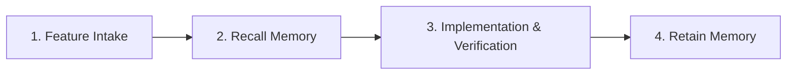

# Hướng Dẫn Sử Dụng Hindsight — Bộ Nhớ Dài Hạn (Long-term Memory) cho AI-Spec

> **Hindsight** (`vectorize-io/hindsight`) là công cụ quản lý ký ức dài hạn (Episodic & Semantic Memory Engine) dành riêng cho các AI Agent (Antigravity, Claude Code, Codex) trong hệ sinh thái `ai-spec`.

---

## 🧠 1. Tại sao cần Hindsight trong Spec-Driven Development?

Trong quy trình phát triển truyền thống với AI:
- Mỗi phiên làm việc (chat session) bắt đầu lại từ con số 0.
- Các bài học từ bug đã fix, quyết định kiến trúc phân tầng (như Anti-Patching, SRP, Transaction boundaries) dễ bị lặp lại lỗi cũ nếu không được lưu vào memory dài hạn.
- Hindsight cung cấp **Memory Bank** cục bộ giúp Agent:
  1. **Recall**: Tự động tra cứu các giải pháp, pattern đã từng giải quyết trong quá khứ trước khi lập plan.
  2. **Retain**: Lưu lại các quyết định kỹ thuật quan trọng và kinh nghiệm sau khi test harness xác thực pass 100%.
  3. **Reflect**: Tổng hợp kiến thức và suy luận đa chiều khi đối mặt với bài toán phức tạp.

---

## 🏗️ 2. Kiến Trúc Hạ Tầng

Hindsight chạy dưới dạng Docker container nội bộ kết nối với LLM (mặc định là Ollama):
- **Container**: `ghcr.io/vectorize-io/hindsight:latest`
- **Cổng API**: `http://localhost:8888` (REST API & Health endpoint)
- **Cổng Web UI**: `http://localhost:9999` (Trực quan hóa đồ thị ký ức)
- **Dữ liệu**: Docker volume `hindsight-data` (lưu trữ vector/graph database)

### Cấu hình biến môi trường (`docker/hindsight/.env`):
```env
HINDSIGHT_API_LLM_PROVIDER=ollama
HINDSIGHT_API_LLM_MODEL=qwen2.5-coder:7b
HINDSIGHT_API_LLM_BASE_URL=http://host.docker.internal:11434

HINDSIGHT_PORT_API=8888
HINDSIGHT_PORT_UI=9999
```

---

## ⚡ 3. Các Lệnh Thao Tác Nhanh (NPM Scripts)

| Lệnh | Ý nghĩa |
| :--- | :--- |
| `npm run hindsight:up` | Khởi động Hindsight Docker container chạy ngầm |
| `npm run hindsight:down` | Dừng và giải phóng container |
| `npm run hindsight:status` | Kiểm tra trạng thái kết nối server và cơ sở dữ liệu |
| `npm run memory:recall -- "<query>"` | Tìm kiếm ký ức liên quan theo ngữ nghĩa |
| `npm run memory:retain -- "<content>" [--context=...]` | Lưu một bài học hoặc quyết định vào memory |
| `npm run memory:reflect -- "<question>"` | Đặt câu hỏi để Hindsight suy luận từ toàn bộ kho ký ức |

---

## 🔄 4. Chu Trình 4 Bước Tích Hợp Vào AGENTS.md

Khi làm việc trên các task có ý nghĩa (Normal hoặc High-risk), Agent tuân thủ chu trình:



### Bước 1: Context Recall (Trước khi viết Plan)
Agent tự động truy vấn ký ức liên quan đến module hoặc lỗi cần xử lý:
```bash
node scripts/hindsight.js recall "quy tắc phân tầng locking và transaction"
```

### Bước 2: Implementation & Verification
Agent lập plan, viết code theo BDD/TDD và chạy verification harness:
```bash
npm run verify
# hoặc: .\scripts\verify.ps1
```

### Bước 3: Knowledge Retention (Sau khi Verify Pass)
Khi kiểm thử thành công 100%, Agent lưu lại bài học nghiệm thu:
```bash
node scripts/hindsight.js retain "Header-Line side effect: luồng recursive không được đè cờ IsActive của Header" --context="arch"
```

---

## 🛡️ 5. Cơ chế Fallback (Graceful Degradation)

Client `scripts/hindsight.js` được thiết kế có cơ chế **Circuit Breaker & Graceful Fallback**:
- Nếu Docker chưa bật hoặc cổng 8888 không phản hồi, client sẽ tự động timeout sau 4000ms và trả về trạng thái cảnh báo an toàn mà **không làm crash quy trình làm việc hay gián đoạn test suite**.
- Toàn bộ unit tests trong `tests/hindsight.test.js` đã được kiểm chứng hoạt động ổn định cả khi online lẫn offline.
