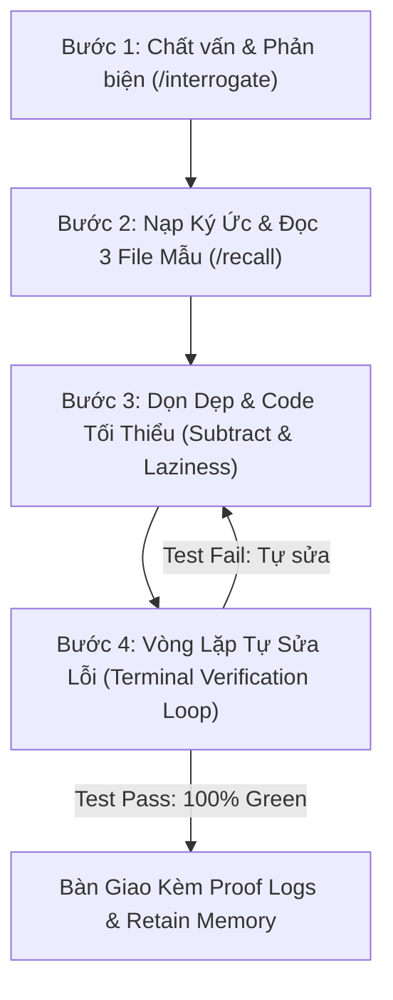

# Cẩm Nang Thực Chiến: pstack + AI-Spec (Lauren Tan Pattern)

> **pstack** là bộ nguyên tắc kỹ thuật và kỹ năng khắt khe do **Lauren Tan** (@poteto - Staff Software Engineer tại SpaceX, cựu kỹ sư Netflix & Spotify) sáng tạo. Khi được tích hợp vào nền tảng **ai-spec**, pstack biến AI Agent từ một cỗ máy "sinh code ẩu" thành một kỹ sư phần mềm cao cấp có kỷ luật, biết tự phản biện và tự kiểm định.

---

## 🎯 1. Tại Sao Cần pstack Trong AI-Spec?

Hầu hết các lập trình viên sử dụng AI đều gặp phải hiện tượng **"AI Slop"**:
- AI tự ý tạo ra hàng trăm dòng code thừa thãi, các hàm wrapper vô nghĩa.
- AI "đoán mò" cấu trúc dự án thay vì quan sát codebase thực tế.
- AI báo cáo "đã làm xong" khi vừa viết code mà chưa hề chạy thử một dòng test nào.

**pstack giải quyết triệt để vấn đề này bằng 4 nguyên tắc cốt lõi:**
1. **Laziness Protocol**: Không viết dòng code nào nếu bài toán có thể giải quyết bằng cách tận dụng hàm có sẵn. Giới hạn mọi thay đổi $\le 3$ files.
2. **Subtract Before You Add**: Luôn tìm cách xóa bỏ dead code, gọt bớt logic trùng lặp trước khi viết thêm cái mới.
3. **Codebase as Memory**: Không tưởng tượng style; bắt buộc đọc ít nhất 3 file tương tự trong dự án để sao chép chuẩn mực.
4. **Self-Verification Guardrail**: Chỉ coi là xong khi Terminal trả về kết quả test xanh 100% kèm bằng chứng thực tế.

---

## ⚡ 2. Bảng Lệnh & Kỹ Năng (Command Cheat Sheet)

| Lệnh / Kỹ năng | Mục đích sử dụng | Khi nào nên dùng? |
| :--- | :--- | :--- |
| **`/poteto-mode [mục tiêu]`** | Kích hoạt chế độ tự hành khép kín (Planning $\to$ Worker $\to$ Verifier Loop $\to$ Handoff). | Khi bắt đầu một tính năng mới cần kỷ luật cao nhất. |
| **`/interrogate`** | Phản biện, bóc tách rủi ro kiến trúc, tìm edge cases và thách thức giả định. | Khi nhận yêu cầu còn mơ hồ, tính năng có độ rủi ro cao (High-risk). |
| **`node scripts/hindsight.js recall "<từ khóa>"`** | Truy vấn ký ức, kinh nghiệm và quyết định kỹ thuật từ Hindsight Memory Bank. | Trước khi lập kế hoạch code (`Pre-flight Recall`). |
| **`node scripts/hindsight.js retain "<bài học>"`** | Đúc kết kinh nghiệm hoặc quyết định kiến trúc vừa giải quyết vào Hindsight Bank. | Sau khi test harness xác thực pass 100% (`Post-flight Retention`). |
| **`.\scripts\verify.ps1`** | Chạy toàn bộ 4 tầng kiểm định (Syntax $\to$ Lint $\to$ Skills $\to$ Unit Tests). | Trước mỗi commit và trước khi bàn giao cho con người. |

---

## 🔄 3. Quy Trình 4 Bước Vận Hành Thực Chiến

### Bước 1: Tiếp nhận & Phản biện (Interrogate)
Đừng bắt tay vào code ngay. Hãy để Agent chất vấn ngược lại để làm rõ:
- Có cần thiết phải viết thêm code không?
- Các trường hợp biên (null, empty, error handling) là gì?
- Thay đổi này ảnh hưởng đến những contract/interface nào?

### Bước 2: Nạp Ký ức & Học từ Codebase
- Agent truy vấn Hindsight Memory để xem bài toán tương tự đã từng được giải quyết ra sao.
- Agent mở và đọc **3 file tương tự** trong dự án để nắm bắt phong cách đặt tên, kiểu dữ liệu và cách xử lý lỗi.

### Bước 3: Dọn dẹp trước khi thêm mới (Subtract Before You Add)
- Kiểm tra file mục tiêu: Có logic nào cũ, dead code, hoặc lặp lại không?
- Xóa bỏ hoặc refactor đoạn cũ trước. Sau đó chỉ viết diff tối thiểu ($\le 3$ files).

### Bước 4: Vòng lặp tự kiểm chứng (Verification Loop)
- Mở Terminal chạy `.\scripts\verify.ps1`.
- Nếu test fail: Agent tự đọc log lỗi, tự chẩn đoán và tự sửa lại (tối đa 3 chu kỳ).
- Khi test pass: Xuất báo cáo bàn giao kèm log chứng minh và lưu bài học vào Hindsight.

---

## 💬 4. Các Mẫu Prompt Chuẩn Điều Khiển Antigravity

### Mẫu 1: Bắt đầu tính năng mới với `/poteto-mode`
> *"/poteto-mode Xây dựng chức năng kiểm tra URL Slug an toàn cho bài viết blog.*  
> *Yêu cầu hệ thống: Áp dụng triệt để nguyên tắc pstack (.agents/rules/pstack.md). Đọc 3 file mẫu trong codebase trước khi viết code, áp dụng Subtract Before You Add để xóa code thừa, và tự động chạy vòng lặp kiểm thử trên Terminal cho đến khi pass 100% trước khi bàn giao cho tôi."*

### Mẫu 2: Phản biện bài toán kiến trúc với `/interrogate`
> *"/interrogate Tôi đang định thêm một bảng mới trong cơ sở dữ liệu để lưu vết trạng thái người dùng.*  
> *Hãy đóng vai trò một Principal Architect, thách thức đề xuất này: Phân tích xem có vi phạm Single Responsibility không? Có giải quyết được bằng bảng hiện có không? Rủi ro về transaction boundary là gì?"*

### Mẫu 3: Tinh giản và dọn dẹp code với `Subtract Before You Add`
> *"Hãy áp dụng nguyên tắc Subtract Before You Add cho file `src/service.js`:*  
> *Trước khi thêm hàm mới `validateSession`, hãy quét toàn bộ file để phát hiện các hàm lặp lại, biến không dùng và dead code. Dọn dẹp chúng trước, chạy test xác nhận không bị gãy rồi mới thêm hàm mới."*
