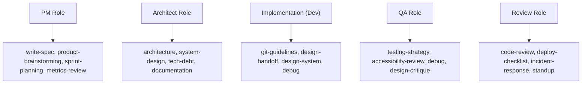

# Hướng Dẫn & Ma Trận Vận Hành Skills Trong Hệ Thống ai-spec

Tài liệu này đóng vai trò là cẩm nang chính quy quy định cách tổ chức, kích hoạt và phối hợp **26 kỹ năng chuyên môn hóa (Skills)** được tích hợp vào nền tảng **Universal AI Spec Kit (`ai-spec`)**.

---

## 1. Kiến Trúc & Cơ Chế Hoạt Động (Progressive Disclosure)

Tất cả các skills được lưu trữ tại:
```text
.agents/skills/<skill-name>/SKILL.md
```

### Cơ chế nạp ngữ cảnh lũy tiến (Progressive Disclosure):
- **Khởi động**: AI Agent (Antigravity, Claude Code, Codex) chỉ đọc phần YAML Frontmatter (`name` và `description`). Toàn bộ 26 skills chỉ tiêu tốn **~1.500 tokens** trong Context Window ban đầu.
- **Kích hoạt có chủ đích**: Nội dung hướng dẫn chi tiết, checklist và template của skill chỉ được nạp vào bộ nhớ làm việc khi:
  1. Người dùng gõ lệnh trực tiếp (ví dụ: `/architecture`, `/code-review`, `/write-spec`).
  2. Agent tự động nhận diện bối cảnh công việc phù hợp với `description` của skill (Model Decision).

---

## 2. Phân Nhóm 26 Kỹ Năng Theo 4 Khối Chức Năng

| Khối Chức Năng | Số lượng | Danh Sách Skills | Mục Tiêu Chính |
| :--- | :---: | :--- | :--- |
| **Engineering** | 10 | `architecture`, `system-design`, `code-review`, `debug`, `testing-strategy`, `tech-debt`, `deploy-checklist`, `incident-response`, `documentation`, `standup` | Đảm bảo kiến trúc phần mềm, bảo mật OWASP, hiệu năng, kiểm thử kim tự tháp, và vận hành an toàn. |
| **Product Management** | 8 | `write-spec`, `product-brainstorming`, `sprint-planning`, `metrics-review`, `roadmap-update`, `stakeholder-update`, `competitive-brief`, `synthesize-research` | Định hình tính năng, phân rã user stories, acceptance criteria BDD, đo lường chỉ số sản phẩm. |
| **Design & UX** | 7 | `design-system`, `design-critique`, `design-handoff`, `accessibility-review`, `ux-copy`, `user-research`, `research-synthesis` | Đồng bộ design tokens, thẩm định trải nghiệm người dùng, chuẩn tiếp cận WCAG 2.1, microcopy. |
| **Spec & Git Hygiene** | 1 | `git-guidelines` | Chuẩn mực commit nguyên tử, thông điệp Conventional Commits, liên kết Spec ID. |

---

## 3. Ma Trận Ánh Xạ: 5 Software Team Roles ↔ Skills

Theo quy định trong [AGENTS.md](file:///d:/AI/ai-spec/AGENTS.md) và [GEMINI.md](file:///d:/AI/ai-spec/GEMINI.md), Agent tự phân vai theo các chế độ làm việc. Ma trận dưới đây xác định skill cốt lõi cho từng role:



### Chi tiết phân vai:
1. **PM (Product Manager)**:
   - `write-spec`: Tạo tài liệu đặc tả tính năng có cấu trúc: Goals, Non-goals, User Stories, MoSCoW, và Acceptance Criteria (Given-When-Then).
   - `product-brainstorming`: Khám phá giải pháp sáng tạo dựa trên vấn đề cốt lõi của người dùng.
   - `sprint-planning` & `roadmap-update`: Sắp xếp độ ưu tiên, phân bổ story points, xác định lộ trình phát hành.
   - `metrics-review`: Đo lường AARRR, North Star, leading và lagging indicators.

2. **Architect**:
   - `architecture`: Lập Architecture Decision Record (ADR) khi lựa chọn công nghệ, phân tích trade-offs và tác dụng phụ (side-effects).
   - `system-design`: Thiết kế hạ tầng dữ liệu, microservices/modular monolith, caching, message queues, giới hạn chịu tải.
   - `tech-debt`: Đánh giá nợ kỹ thuật, lập bảng điểm refactoring và chiến lược hoàn nợ.

3. **Implementation (Developer)**:
   - `git-guidelines`: Kiểm soát commit nguyên tử ($\le 3$ files), kiểm chứng trước commit (`verify`), đúng header `<type>(<scope>): <desc>`.
   - `design-handoff` & `design-system`: Chuyển đổi design tokens và responsive layout sang code sạch, tái sử dụng components.
   - `debug`: Tìm nguyên nhân gốc rễ (Root Cause) theo giả thuyết khoa học thay vì đoán mò.

4. **QA (Quality Assurance)**:
   - `testing-strategy`: Thiết kế chiến lược kiểm thử đa tầng (Unit, Integration, End-to-End, BDD spec mapping, Edge cases).
   - `accessibility-review`: Kiểm tra khả năng tiếp cận WCAG 2.1 AA (màu sắc tương phản, keyboard trap, screen reader, ARIA).
   - `design-critique`: Rà soát trải nghiệm UI theo 10 Nielsen Norman heuristics.

5. **Review**:
   - `code-review`: Rà soát bảo mật (OWASP Top 10), hiệu năng (N+1 query, rò rỉ bộ nhớ), tính đúng đắn (race condition, null check).
   - `deploy-checklist`: Đảm bảo quy trình deploy không downtime, kiểm tra rollback, migration database, canary testing.

---

## 4. Ánh Xạ Vào Chu Trình Phát Triển 5 Bước (ai-spec SDD Loop)

```text
[1. Spec BDD] ➜ [2. Plan Architecture] ➜ [3. Atomic TDD Execution] ➜ [4. Verify Harness] ➜ [5. Sync Progress]
```

- **Bước 1 — Spec BDD**:
  - Dùng `write-spec` và `product-brainstorming` để sinh nội dung `spec.md` sắc bén, đầy đủ edge cases và kịch bản Given-When-Then.
- **Bước 2 — Plan Architecture**:
  - Dùng `architecture` và `system-design` để hoàn thiện `plan.md`, thiết lập schema thực thể kế thừa `BaseEntity`, ranh giới transaction.
- **Bước 3 — Atomic TDD Execution**:
  - Dùng `testing-strategy` để sinh Red phase test trước khi viết logic; dùng `debug` khi gặp bug; dùng `git-guidelines` để commit atomic.
- **Bước 4 — Verify Harness**:
  - Dùng `code-review` và `accessibility-review` để thực hiện peer-review độc lập trước khi chốt tính năng.
- **Bước 5 — Sync Progress**:
  - Dùng `standup`, `roadmap-update`, và `deploy-checklist` để cập nhật tiến độ vào `tasks.md` và chuẩn bị bàn giao.

---

## 5. Danh Mục Tra Cứu Nhanh Tất Cả 26 Skills

| Tên Skill | Mô Tả Ngắn Gọn | Trình Kích Hoạt Đề Xuất |
| :--- | :--- | :--- |
| `accessibility-review` | Rà soát WCAG 2.1 AA, keyboard nav, screen reader, color contrast | "review accessibility", "WCAG audit", UI check |
| `architecture` | Tạo ADR, so sánh giải pháp kiến trúc, trade-offs | "ADR", "choose technology", "architectural decision" |
| `code-review` | Rà soát mã nguồn về Security, Performance, Concurrency, Clean Code | "code review", "is this safe?", "review PR" |
| `competitive-brief` | Phân tích đối thủ cạnh tranh, tính năng khác biệt | "competitor analysis", "market alternatives" |
| `debug` | Phương pháp gỡ lỗi khoa học, hypothesis, root cause analysis | "debug error", "why is this failing", "root cause" |
| `deploy-checklist` | Checklist chuẩn bị deploy, database migration, rollback | "deploy checklist", "release readiness", "go-live" |
| `design-critique` | Đánh giá giao diện UI/UX theo tiêu chuẩn thiết kế | "critique UI", "evaluate design", "UX feedback" |
| `design-handoff` | Chuyển giao thiết kế UI sang implementation code | "design handoff", "implement component", "tokens" |
| `design-system` | Xây dựng tokens, reusable UI components, styling guidelines | "design system", "design tokens", "component library" |
| `documentation` | Chuẩn hóa tài liệu kỹ thuật, API references, architecture docs | "document this", "write API docs", "README update" |
| `git-guidelines` | Kỷ luật commit Git, Conventional Commits, Spec ID linking | "git commit", "commit message", "PR review" |
| `incident-response` | Xử lý sự cố production khẩn cấp, triage, postmortem | "production incident", "outage", "postmortem" |
| `metrics-review` | Thiết lập KPI, đo lường AARRR, North Star metrics | "product metrics", "success criteria", "KPI review" |
| `product-brainstorming`| Khám phá ý tưởng sản phẩm, giải quyết bài toán người dùng | "brainstorm features", "ideate solution" |
| `research-synthesis` | Tổng hợp kết quả phỏng vấn và thử nghiệm người dùng | "synthesize UX research", "interview insights" |
| `roadmap-update` | Cập nhật lộ trình phát triển theo releases và milestones | "update roadmap", "release planning" |
| `sprint-planning` | Lập kế hoạch sprint, phân chia points, MoSCoW sorting | "sprint planning", "backlog grooming" |
| `stakeholder-update` | Báo cáo cập nhật tình hình dự án cho ban điều hành | "stakeholder update", "executive summary" |
| `standup` | Báo cáo công việc hàng ngày, tiến độ, blockers ngắn gọn | "daily standup", "what was done today" |
| `synthesize-research` | Phân tích dữ liệu thị trường định lượng & định tính, persona | "market research", "opportunity sizing" |
| `system-design` | Thiết kế hệ thống chịu tải cao, data partitioning, caching | "system design", "distributed architecture" |
| `tech-debt` | Định lượng nợ kỹ thuật, kế hoạch refactor hệ thống | "tech debt audit", "refactoring plan" |
| `testing-strategy` | Chiến lược kiểm thử, test pyramid, test cases BDD | "testing strategy", "test plan", "test coverage" |
| `user-research` | Kịch bản khảo sát và phỏng vấn người dùng thực tế | "user research guide", "interview script" |
| `ux-copy` | Chuẩn hóa câu chữ giao diện, empty states, error messages | "ux copy", "error message text", "microcopy" |
| `write-spec` | Viết PRD / Feature Spec chi tiết kèm BDD Acceptance Criteria | "write spec", "feature PRD", "acceptance criteria" |
