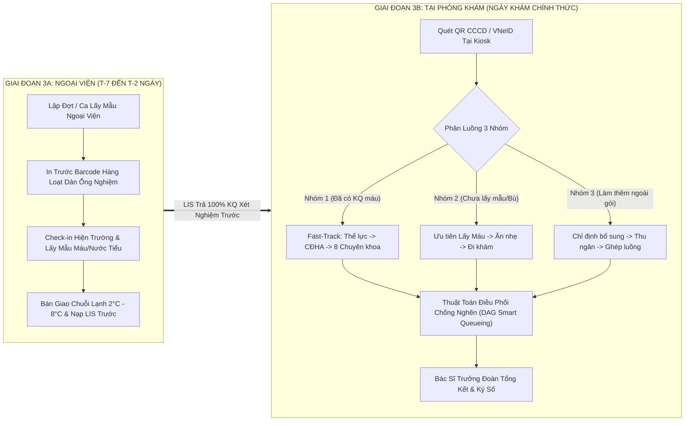
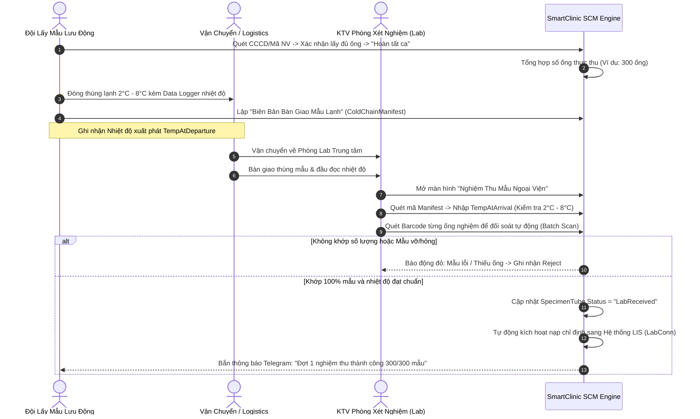
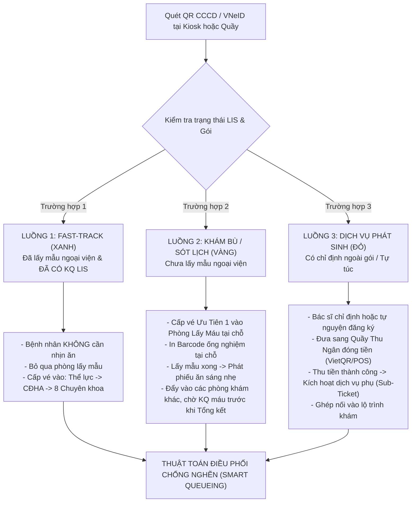

# ĐẶC TẢ WORKFLOW 03A & 03B: TIỀN TRẠM LẤY MẪU NGOẠI VIỆN & TIẾP NHẬN ĐIỀU PHỐI THÔNG MINH
## (SmartClinicManagement — Enterprise Healthcare Architecture)

---
- **Mã tài liệu:** `SPEC-WORKFLOW-03-RECEPTION-QUEUEING`
- **Phiên bản:** `2.0.0 (Wave 3 & Wave 4 Foundation)`
- **Ngày ban hành:** 23/11/2026
- **Trạng thái:** `Approved & Ready for Implementation`
- **Áp dụng:** Phân hệ Ngoại Viện (`SCM.PreExam`) & Phân hệ Tiếp Nhận - Điều Phối (`SCM.Reception` & `SCM.Queueing`)
- **Tài liệu căn cứ:**
  - [MASTER-ROADMAP-WORKFLOWS-SCM.md](file:///d:/workspace/001_YTE/VSC/VSC_20170828/Docs/MASTER-ROADMAP-WORKFLOWS-SCM.md)
  - [SPEC-WORKFLOW-GOI-KHAM-V2-CONG-QUOC-GIA.md](file:///d:/workspace/001_YTE/VSC/VSC_20170828/Docs/SPEC-WORKFLOW-GOI-KHAM-V2-CONG-QUOC-GIA.md)
  - [SPEC-02-ARCH-RECEPTION-BILLING.md](file:///d:/workspace/001_YTE/VSC/VSC_20170828/Docs/SPEC-02-ARCH-RECEPTION-BILLING.md)
  - Kế thừa và hiện đại hóa từ màn hình Legacy `uPatientList_Remote.cs` (VSC WinForms)

---

## 1. TỔNG QUAN HAI GIAI ĐOẠN NGHIỆP VỤ (PHASE 3A & PHASE 3B)

Trong quy trình khám sức khỏe định kỳ doanh nghiệp quy mô lớn (từ vài trăm đến hàng chục nghìn nhân viên), việc tổ chức khám tập trung trong 1 ngày duy nhất luôn gây quá tải trầm trọng tại khu vực lấy máu và chẩn đoán hình ảnh. 

Hệ thống **SmartClinicManagement** chia quy trình khám đoàn thành **2 Phase độc lập nhưng liên kết chặt chẽ**:



---

## 2. WORKFLOW 03A: TIỀN TRẠM LẤY MẪU NGOẠI VIỆN (PRE-EXAM MOBILE PHLEBOTOMY)

### 2.1. Cấu Trúc Database 100% Relational (SCM.Domain & SCM.EntityFrameworkCore)

Mô hình dữ liệu tuân thủ chuẩn 4 tầng (Master $\to$ Scope $\to$ Timeline $\to$ Derivative), cấm tuyệt đối JSON blob:

```mermaid
erDiagram
    Company ||--o{ PhlebotomyBatch : "tổ chức theo"
    CompanyContract ||--o{ PhlebotomyBatch : "thuộc hợp đồng"
    Package ||--o{ PhlebotomyBatch : "áp dụng gói"
    PhlebotomyBatch ||--o{ BatchEmployeeMapping : "chứa danh sách"
    CompanyEmployee ||--o{ BatchEmployeeMapping : "được xếp vào"
    BatchEmployeeMapping ||--o{ SpecimenTube : "phát sinh các ống mẫu"
    PhlebotomyBatch ||--o{ ColdChainManifest : "bàn giao qua"
    ColdChainManifest ||--o{ SpecimenTube : "vận chuyển"

    PhlebotomyBatch {
        Guid Id PK
        Guid CompanyId FK
        Guid ContractId FK
        Guid PackageId FK
        string BatchCode UK "Mã đợt (VD: DOT-202611-FPT-01)"
        string BatchName "Tên đợt (VD: Khám lấy mẫu Tòa nhà FPT Cầu Giấy)"
        datetime SamplingDate "Ngày lấy mẫu dự kiến"
        string SamplingLocation "Địa điểm lấy mẫu cụ thể"
        int PlannedCount "Số CBNV dự kiến"
        int ActualCollectedCount "Số CBNV thực tế đã lấy"
        int BatchStatus "0: Lập lịch, 1: Đã in barcode, 2: Đang lấy mẫu, 3: Đã bàn giao Lab, 4: Hoàn tất"
    }

    BatchEmployeeMapping {
        Guid Id PK
        Guid BatchId FK
        Guid EmployeeId FK
        int ShiftOrder "Ca khám (1: Sáng sớm 6h-8h, 2: 8h-10h, 3: Chiều)"
        datetime CheckinTime "Thời điểm quét mã check-in hiện trường"
        bool IsCollected "Đã lấy đủ mẫu chưa"
        string CollectorStaff "Nhân viên y tế lấy mẫu"
        string SamplingNotes "Ghi chú (Khó lấy ven, ngất xỉu, vắng mặt)"
    }

    SpecimenTube {
        Guid Id PK
        Guid BatchEmployeeMappingId FK
        Guid EmployeeId FK
        string TubeBarcode UK "Mã vạch Code128 dán trên ống"
        int TubeType "1: EDTA, 2: Serum_Gel, 3: Heparin, 4: NaF, 5: Urine"
        string CapColor "Tím, Đỏ/Vàng, Xanh lá, Xám, Trắng/Vàng"
        string TargetTests "Mã test LIS (CBC, GLU, URE, CRE, CHOL, TRIG, SGOT, SGPT)"
        int TubeStatus "0: Đã in tem, 1: Đã thu mẫu, 2: Đóng thùng lạnh, 3: Lab đã nhận, 4: Hủy/Mẫu hỏng"
        datetime CollectedAt "Giờ lấy mẫu thực tế"
        string CollectorId "Mã ĐDV/KTV lấy mẫu"
        Guid? ManifestId FK "Mã biên bản chuỗi lạnh"
    }

    ColdChainManifest {
        Guid Id PK
        Guid BatchId FK
        string ManifestCode UK "Số biên bản bàn giao (VD: MAN-20261123-01)"
        string HandoverStaff "Người bàn giao (Đội lưu động)"
        string CourierStaff "Người vận chuyển (Tài xế/Logistics)"
        string LabReceiverStaff "Người nhận mẫu tại phòng Lab"
        datetime DepartureTime "Giờ xuất phát từ hiện trường"
        datetime ArrivalTime "Giờ đến phòng xét nghiệm"
        decimal TempAtDeparture "Nhiệt độ lúc đi (Chuẩn 2.0°C - 8.0°C)"
        decimal TempAtArrival "Nhiệt độ lúc tới (Chuẩn 2.0°C - 8.0°C)"
        int TotalTubesHandedOver "Tổng số ống bàn giao"
        int TotalTubesAccepted "Tổng số ống Lab nghiệm thu"
        int TotalTubesRejected "Tổng số ống Lab từ chối (Đông dây, vỡ, sai thể tích)"
        int ManifestStatus "0: Đang di chuyển, 1: Đã nghiệm thu, 2: Sự cố đứt gãy nhiệt độ"
    }
```

### 2.2. Cơ Chế In Trước Barcode Hàng Loạt (Batch Barcode Pre-Printing Engine)

1. **Quy chuẩn định dạng mã Barcode (Code128 / GS1-128):**
   - Cấu trúc mã vạch 14 ký tự:
     $$\text{TubeBarcode} = \underbrace{\text{PKG}}_{\text{Tiền tố (3)}} + \underbrace{\text{T}}_{\text{Loại ống (1)}} + \underbrace{\text{YYMMDD}}_{\text{Ngày lấy (6)}} + \underbrace{\text{NNNN}}_{\text{Số hồ sơ (4)}}$$
   - Bảng ánh xạ loại ống và màu nắp theo chuẩn quốc tế CLSI:
     - `E` (Màu Tím - EDTA K2/K3): Huyết học tổng quát, HbA1c.
     - `S` (Màu Vàng/Đỏ - Serum Clot Activator / Gel): Sinh hóa, Miễn dịch, Men gan, Bộ mỡ, Viêm gan B/C.
     - `F` (Màu Xám - NaF Sodium Fluoride): Định lượng Đường huyết (Glucose chống tiêu đường).
     - `U` (Lọ Nước Tiểu 50ml nắp vàng): Tổng phân tích nước tiểu 10-11 thông số.

2. **Thuật toán sinh danh sách tem in tự động:**
   ```csharp
   // Logic phân giải dịch vụ trong gói thành danh sách ống nghiệm cần in
   public List<SpecimenTubeDraft> ResolveRequiredTubes(CompanyEmployee employee, Package package)
   {
       var tubes = new List<SpecimenTubeDraft>();
       var services = package.Services;

       // 1. Kiểm tra có xét nghiệm Huyết học -> Cần 1 ống EDTA (Tím)
       if (services.Any(s => s.ServiceCode.StartsWith("XN_HH_")))
       {
           tubes.Add(new SpecimenTubeDraft(TubeType.EDTA, "Tím", employee));
       }

       // 2. Kiểm tra có xét nghiệm Sinh hóa / Miễn dịch -> Cần 1 ống Serum Gel (Vàng/Đỏ)
       if (services.Any(s => s.ServiceCode.StartsWith("XN_SH_") || s.ServiceCode.StartsWith("XN_MD_")))
       {
           tubes.Add(new SpecimenTubeDraft(TubeType.Serum_Gel, "Vàng", employee));
       }

       // 3. Kiểm tra có xét nghiệm Nước tiểu -> Cần 1 Lọ Nước Tiểu
       if (services.Any(s => s.ServiceCode.StartsWith("XN_NT_")))
       {
           tubes.Add(new SpecimenTubeDraft(TubeType.Urine, "Vàng/Trắng", employee));
       }

       return tubes;
   }
   ```

3. **Quy cách nhãn in nhiệt cuộn (Thermal Roll Label):**
   - Kích thước tem: `35mm x 22mm` hoặc `50mm x 30mm`.
   - Nội dung hiển thị trên mặt tem:
     - Dòng 1: Tên Doanh nghiệp viết tắt + Mã đợt (VD: `FPT - CA 1`).
     - Dòng 2: Họ tên CBNV (viết hoa không dấu) + Năm sinh + Giới tính (VD: `NGUYEN VAN A - 1988 - NAM`).
     - Dòng 3: Mã vạch Barcode Code128 + Mã số người đọc (Human Readable Text).
     - Dòng 4: Tên loại ống và danh sách xét nghiệm tóm tắt (VD: `EDTA: CTM, HbA1c`).

### 2.3. Quy Trình Logistics & Chuỗi Lạnh Bàn Giao Mẫu (Cold Chain Protocol)



---

## 3. WORKFLOW 03B: TIẾP NHẬN THÔNG MINH & THUẬT TOÁN ĐIỀU PHỐI (SMART QUEUEING)

### 3.1. Phân Loại 3 Luồng Vận Hành Cốt Lõi Tại Quầy / Kiosk Tiếp Đón

Khi CBNV đến phòng khám trong ngày khám chính thức, họ quét mã **QR trên thẻ CCCD** hoặc ứng dụng **VNeID** tại Kiosk tiếp nhận tự động. Bộ định tuyến tiếp đón (`ReceptionRouter`) phân loại tức thì theo 3 luồng:



### 3.2. Thuật Toán Điều Phối Động Chống Nghẽn Cục Bộ (Dynamic Room Balancing DAG)

#### A. Ràng buộc y khoa bất biến (Invariants & Hard Constraints)
1. **Ràng buộc Tiền Trạm (Fasting Rule):** Nếu bệnh nhân thuộc Luồng 2 (chưa lấy máu), **bắt buộc** phải hoàn tất phòng Lấy Máu trước khi được ăn sáng và trước khi vào các phòng khám khác.
2. **Ràng buộc Siêu Âm Ổ Bụng (Ultrasound Rule):** Siêu âm bụng tổng quát cần nhịn ăn và bàng quang căng (nhịn tiểu). Do đó, bệnh nhân nên được điều phối vào phòng Siêu âm trước khi khám phụ khoa hoặc đi tiểu làm xét nghiệm.
3. **Ràng buộc Chẩn Đoán Hình Ảnh Nữ (Pregnancy Shield):** Phòng Chụp X-quang và Đo loãng xương tuyệt đối cấm đưa phụ nữ mang thai hoặc nghi ngờ mang thai vào. Bắt buộc có cờ xác nhận `NotPregnant` từ người bệnh.
4. **Ràng buộc Thứ Tự Khám Thể Lực:** Bắt buộc có kết quả đo Thể lực (Chiều cao, Cân nặng, Mạch, Huyết áp, BMI) trước khi Bác sĩ Nội khoa và Bác sĩ Trưởng đoàn khám kết luận.
5. **Ràng buộc Phòng Tổng Kết (Final Review):** Phòng Bác sĩ Trưởng đoàn chỉ được phép gọi bệnh nhân vào khi **100% các phòng chỉ định, hình ảnh PACS và kết quả LIS đã có trạng thái `COMPLETED`**.

#### B. Hàm mục tiêu tính điểm ưu tiên phòng khám (Cost Function)
Khi một bệnh nhân $P$ hoàn thành một phòng khám và cần chuyển sang phòng tiếp theo, thuật toán duyệt qua danh sách các phòng khám còn lại trong lộ trình của bệnh nhân $S_{remain}(P) = \{ R_1, R_2, \dots, R_k \}$.

Điểm chi phí (Cost Score) của mỗi phòng khám $R_i$ được tính theo công thức:
$$\text{Score}(P, R_i) = w_1 \cdot T_{\text{wait}}(R_i) + w_2 \cdot \text{Dist}(L_{curr}, L_{R_i}) - w_3 \cdot \text{Urgency}(P, R_i)$$

Trong đó:
- $T_{\text{wait}}(R_i) = N_{\text{queue}}(R_i) \times D_{\text{avg}}(R_i)$: Thời gian chờ ước tính tại phòng $R_i$ ($N_{\text{queue}}$ là số người đang chờ, $D_{\text{avg}}$ là thời lượng khám trung bình tại phòng đó, ví dụ: Siêu âm là 7 phút, Mắt là 3 phút, Thể lực là 2 phút).
- $\text{Dist}(L_{curr}, L_{R_i})$: Khoảng cách vật lý giữa vị trí hiện tại của bệnh nhân và phòng khám (Ví dụ: Cùng Tầng 1 $= 0$, Khác tầng $= 5$).
- $\text{Urgency}(P, R_i)$: Điểm cấp bách y khoa (Ví dụ: Phòng lấy máu cho bệnh nhân đang đói $= 20$, Siêu âm bụng đang nhịn tiểu $= 15$).
- Bộ trọng số chuẩn: $w_1 = 0.5, w_2 = 0.2, w_3 = 0.3$.

Phòng khám có **$\text{Score}(P, R_i)$ THẤP NHẤT** sẽ được chọn để gán STT cho bệnh nhân.

#### C. Cơ chế phá nút thắt cổ chai (Bottleneck Breaker)
- **Ngưỡng nghẽn tới hạn (Threshold):** Nếu phòng Siêu âm hoặc phòng Mắt có $N_{\text{queue}} \ge 12$ người hoặc $T_{\text{wait}} \ge 35$ phút:
  - Hệ thống tự động kích hoạt chế độ **Phân tán hàng đợi (Queue Dispersal)**: Tạm thời hạ trọng số ưu tiên của phòng này xuống thấp nhất đối với tất cả bệnh nhân mới đến.
  - Điều hướng toàn bộ bệnh nhân có thể làm dịch vụ song song sang các phòng chuyên khoa vắng vẻ (Tai Mũi Họng, Răng Hàm Mặt, Da Liễu, Ngoại khoa).
  - Khi $N_{\text{queue}}$ tại phòng nghẽn giảm xuống dưới 6 người, thuật toán tự động cân bằng trở lại trạng thái bình thường.

### 3.3. Cơ Chế Khóa Kiểm Soát Đồng Thời (Concurrency Control & Anti-Race Condition)

Để ngăn chặn lỗi xung đột trong môi trường hàng nghìn người cùng khám (như 2 phòng gọi cùng 1 người, hoặc 2 Kiosk cấp trùng 1 số STT):
1. **Pessimistic Row-Level Lock:** Áp dụng khóa bi quan trên dòng bản ghi khi cấp số và gọi số:
   ```sql
   -- Truy vấn lấy bệnh nhân tiếp theo tại phòng khám R_05
   SELECT TOP (1) QueueTicketId, PatientId, TicketNumber
   FROM SCM_QueueTickets WITH (UPDLOCK, ROWLOCK)
   WHERE RoomId = @TargetRoomId AND Status = 0 -- Đang chờ
   ORDER BY Priority DESC, TicketNumber ASC;
   ```
2. **Atomic Status Transition:** Bệnh nhân chỉ được có duy nhất **1 vé ở trạng thái `IN_PROGRESS` (Đang khám)** trên toàn bộ hệ thống. Khi phòng A bấm "Đang khám", hệ thống lập tức khóa không cho bất kỳ phòng B nào gọi tên bệnh nhân này.

---

## 4. BẢN ĐẶC TẢ GIAO DIỆN NGƯỜI DÙNG (UI/UX SPECIFICATIONS)

Tuân thủ nghiêm ngặt chuẩn **UI/UX Governance v2.1** (Semantic Tokens, 4 UI States, Viewport 1366x768 / 1440x900, Escape/Backdrop dismissal):

### 4.1. Màn hình Quản Lý Đợt Lấy Mẫu Ngoại Viện (`PhlebotomyBatchManager.tsx`)
- **Vị trí thanh điều hướng:** `Menu` $\to$ `Khám Đoàn` $\to$ `Tiền Trạm Lấy Mẫu (WF 03A)`.
- **Bố cục chính:**
  - Header: Thẻ chọn Công ty B2B + Hợp đồng + Nút `+ Tạo Đợt Mới`, `In Tem Hàng Loạt`, `Biên Bản Chuỗi Lạnh`.
  - Bộ lọc KPI nhanh: Tổng CBNV, Đã in tem, Đã lấy mẫu, Đã nhập Lab, Tỷ lệ hoàn thành (ProgressBar).
  - Bảng danh sách đợt khám: Hiển thị Đợt khám, Ngày lấy, Địa điểm, Số lượng, Trạng thái đợt.
  - Drawer chi tiết: Cho phép kéo thả phân ca CBNV, gán nhân viên y tế phụ trách.

### 4.2. Màn hình Check-in Quét Mẫu Hiện Trường (`MobileSamplingScanner.tsx`)
- **Thiết bị mục tiêu:** Máy tính bảng (Tablet) / Laptop di động tại hiện trường nhà máy.
- **Tính năng trọng tâm:**
  - Ô quét Barcode / CCCD tự động focus liên tục (Auto-focusing).
  - Âm thanh phản hồi: Bíp ngắn (Thành công - Xanh), Bíp dài kép (Cảnh báo trùng/Sai đối tượng - Đỏ).
  - Danh sách ống cần thu hiện rõ màu sắc tương ứng: `[Tím - EDTA] [Vàng - Serum] [Trắng - Nước tiểu]`.
  - Nút bấm lớn một chạm: `Đã Lấy Đủ Mẫu (Spacebar / Enter)` hoặc `Lấy Mẫu Thiếu (F4)`.

### 4.3. Bảng Điều Phối Phòng Khám Thông Minh (`SmartQueueDashboard.tsx`)
- **Màn hình trung tâm điều hành (Control Tower):**
  - Hiển thị toàn bộ các phòng khám dưới dạng lưới Grid Cards (Phòng 101: Thể lực, Phòng 102: Lấy máu, Phòng 201: X-quang, Phòng 202: Siêu âm...).
  - Mỗi Card hiển thị: Tên Bác sĩ, Số người đang chờ ($N_{\text{wait}}$), Thời gian chờ trung bình ($T_{\text{wait}}$), Bệnh nhân đang khám trong phòng.
  - Màu cảnh báo tải phòng: Xanh lá (Bình thường $< 5$ người), Vàng (Đông $5 - 10$ người), Đỏ (Nghẽn $> 10$ người).
  - Khả năng can thiệp của Quản đốc (HITL Override): Bác sĩ trưởng đoàn có quyền kéo thả bệnh nhân ưu tiên đặc biệt hoặc tạm dừng điều phối vào một phòng cụ thể.

### 4.4. Màn hình Hiển Thị Gọi Số Tại Cửa Phòng Khám (`RoomCallDisplay.tsx`)
- **Màn hình Tivi / LCD trước cửa từng phòng khám:**
  - Kích thước chữ số hiển thị cực lớn, độ tương phản cao (`text-primary`, nền `bg-card`).
  - Hiển thị 3 khối thông tin:
    - `ĐANG KHÁM`: Số STT + Họ tên CBNV.
    - `MỜI VÀO TIẾP THEO`: Số STT + Họ tên CBNV tiếp theo.
    - `DANH SÁCH CHUẨN BỊ`: 3 người tiếp theo để người bệnh chủ động ngồi chờ trước cửa.
  - Tích hợp giọng đọc trợ lý ảo tự động (Text-to-Speech): *"Xin mời số 1025, Nguyễn Văn A vào phòng Siêu âm số 2"*.

---

## 5. BỘ TIÊU CHÍ NGHIỆM THU CHUẨN BDD (ACCEPTANCE CRITERIA)

### AC-03A.1: In trước Barcode dán ống nghiệm
- **Given:** Gói KSK đoàn có danh mục xét nghiệm gồm Tổng phân tích máu (CBC) và Glucose, Men gan (SGOT, SGPT).
- **When:** Điều phối viên bấm "In Tem Hàng Loạt" cho Ca 1 gồm 100 nhân viên.
- **Then:** Hệ thống phải sinh đúng 200 tem nhãn barcode Code128 (100 ống EDTA Tím và 100 ống Serum Vàng), mã vạch không được trùng lặp, trên tem hiển thị rõ họ tên, năm sinh, mã nhân viên và mã xét nghiệm.

### AC-03A.2: Kiểm soát nhiệt độ chuỗi lạnh bàn giao mẫu
- **Given:** Đội lưu động bàn giao 500 ống máu cho nhân viên vận chuyển về phòng xét nghiệm.
- **When:** KTV phòng Lab mở màn hình "Nghiệm Thu Mẫu" và nhập nhiệt độ thùng lạnh lúc nhận mẫu là $9.5^\circ\text{C}$ (Vượt ngưỡng chuẩn $2.0^\circ\text{C} - 8.0^\circ\text{C}$).
- **Then:** Hệ thống lập tức hiển thị cảnh báo đỏ `CẢNH BÁO: ĐỨT GÃY CHUỖI LẠNH`, đánh dấu trạng thái Manifest là `TemperatureBreached`, không cho phép tự động nạp mẫu vào máy LIS khi chưa có chữ ký xác nhận trách nhiệm của Trưởng phòng Lab.

### AC-03B.1: Định tuyến tự động 3 Luồng tại Kiosk
- **Given:** Ba nhân viên A, B, C quét thẻ CCCD tại Kiosk tiếp đón.
  - Nhân viên A: Đã lấy mẫu máu ngoại viện 2 ngày trước, kết quả LIS đã trả đủ.
  - Nhân viên B: Vắng mặt hôm lấy mẫu ngoại viện, chưa có kết quả xét nghiệm.
  - Nhân viên C: Đã có kết quả máu nhưng đăng ký làm thêm Siêu âm tim ngoài gói.
- **When:** Kiosk in phiếu hướng dẫn khám.
- **Then:** 
  - Nhân viên A nhận vé Luồng 1 (Xanh), phiếu hướng dẫn ghi rõ: "Không cần nhịn ăn, mời đến Phòng 101 Khám Thể Lực".
  - Nhân viên B nhận vé Luồng 2 (Vàng), phiếu ưu tiên số 1: "Mời đến ngay Phòng 102 Lấy Máu Xét Nghiệm, sau đó nhận phần ăn sáng".
  - Nhân viên C nhận vé Luồng 3 (Đỏ), phiếu hướng dẫn: "Mời đến Quầy Thu Ngân số 3 để hoàn tất phí dịch vụ phát sinh".

### AC-03B.2: Tự động điều phối chống nghẽn phòng Siêu âm
- **Given:** Phòng Siêu âm 1 và 2 đều đang có 14 người chờ ($T_{\text{wait}} \approx 45$ phút), trong khi Phòng Tai Mũi Họng và Răng Hàm Mặt chỉ có 1 người chờ.
- **When:** Bệnh nhân D vừa hoàn thành xong phòng khám Thể lực.
- **Then:** Thuật toán Smart Queueing tính toán Cost Score và tự động điều phối bệnh nhân D sang phòng Tai Mũi Họng hoặc Răng Hàm Mặt trước, hoãn lượt Siêu âm đến khi hàng đợi Siêu âm giảm tải xuống dưới 6 người.

### AC-03B.3: Khóa an toàn trước khi vào phòng Bác sĩ Trưởng đoàn
- **Given:** Bệnh nhân E đã khám xong 7 chuyên khoa, chụp X-quang xong, nhưng chưa có kết quả xét nghiệm máu từ phòng Lab.
- **When:** Bác sĩ Trưởng đoàn tại Phòng Tổng kết bấm nút "Gọi Bệnh Nhân Tiếp Theo".
- **Then:** Hệ thống tuyệt đối không hiển thị bệnh nhân E trong danh sách chờ gọi của phòng Tổng kết, đồng thời hiển thị huy hiệu `Chờ Kết Quả LIS (1 chỉ số)` trên màn hình theo dõi tiến độ toàn viện.

---

## 6. MA TRẬN RỦI RO VÀ GIẢI PHÁP PHÒNG NGỪA (RISK MATRIX)

- **Rủi ro Đỏ (Critical):** Trộn lẫn hoặc thất lạc ống nghiệm không dán tem tại hiện trường nhà máy.
  - *Giải pháp:* Bắt buộc in tem trước 100% tại phòng khám, dán sẵn ống theo bộ đựng trong túi zip riêng cho từng nhân viên trước khi đội lưu động lên đường.
- **Rủi ro Vàng (High):** Mất mạng Internet tại hiện trường nhà máy không gửi được dữ liệu check-in về máy chủ.
  - *Giải pháp:* Xây dựng cơ chế Offline-First Local Storage trên Web/PWA, lưu trữ dữ liệu quét vào IndexedDB cục bộ và tự động đồng bộ (Outbox Sync) khi có mạng trở lại.
- **Rủi ro Xanh (Medium):** Người bệnh không biết vị trí phòng khám dẫn đến đi lạc làm tăng thời gian chờ.
  - *Giải pháp:* In kèm sơ đồ phòng khám mini trên phiếu số thứ tự, kết hợp hiển thị mũi tên chỉ đường trên màn hình LCD các ngã rẽ hành lang.
